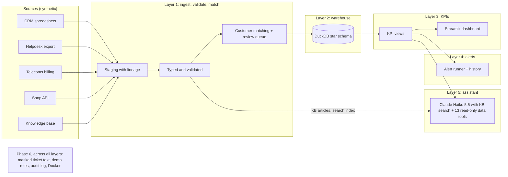
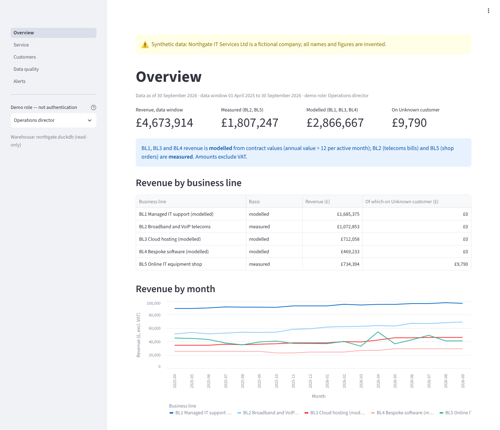
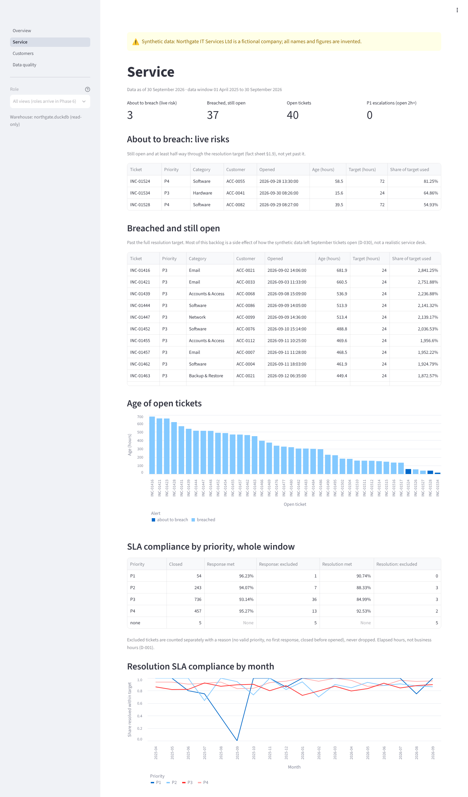
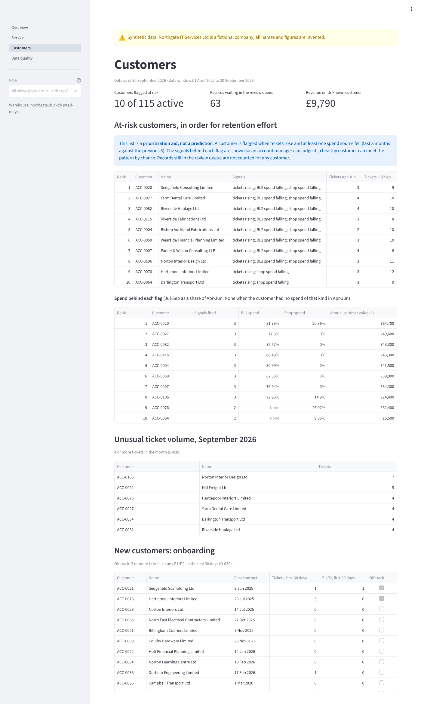
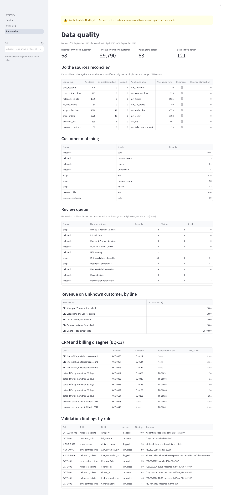

# Northgate Ops Intel

Northgate IT Services Ltd is a **fictional** company, and all data here is **synthetic**: generated from a fixed
seed, with deliberate quality problems planted in it and an answer key recording every one. The code was written
by an AI builder (Claude) under my direction. I approved each step before it was built, reviewed it afterwards,
and re-checked the results with a second AI reviewer working independently of the builder; see
[How the results were checked](#how-the-results-were-checked).

> "Northgate IT Services Ltd" is a made-up name with no connection to any real company called Northgate,
> including Northgate plc in Darlington. No real company's name, branding or data is used.

## Two-minute summary

**The problem.** Northgate is a managed IT services provider with five business lines. Its data sits in four
systems that don't agree: a CRM spreadsheet, a helpdesk, a telecoms billing export and a web shop, plus a
knowledge base. Customer names are spelt differently in each, dates and amounts come in mixed formats, records are
duplicated, and managers answer questions such as "which customers are at risk?" or "are we meeting our SLAs?"
by hand, if at all ([`docs/02_as_is_architecture.md`](docs/02_as_is_architecture.md)).

**What the prototype does.** It ingests and validates all five sources, matches each record to one customer, and
loads a star-schema warehouse in DuckDB. On top of that it computes KPI views for 14 of the 16 business questions,
shows the main ones on a Streamlit dashboard and raises alerts. An AI assistant (Claude Haiku 5.5) answers from the knowledge base and from
read-only data tools, citing its sources, and says so when it can't answer. Ticket text is masked; demo roles
decide who sees what; an audit log records actions; and the whole thing runs in Docker.

**Headline results**

| Result | Figure | Detail |
|---|---|---|
| Customer matching | **0 wrong automatic matches out of 2,937** records on the held-out half (5,535 automatic matches across both halves, after one development-half error was found and fixed) | D-020, D-021 |
| Revenue | **All five business lines reconcile** with the generator's independent figures, total £4,673,914.13; each gap is under £1 and comes from the references being reported in whole pounds | D-026 |
| AI assistant | **13 of 14 held-out questions**, run once against the frozen assistant; the one failure was a correct answer the checker could not verify | D-042 |
| Masking personal data | **302 of 302** planted names, phone numbers and emails caught on held-out tickets, 0 false masks, on synthetic data | D-043 |

What it does not do, and where the results are weaker, is under [Known limitations](#known-limitations).

## How the results were checked

- **An answer key the pipeline never reads.** The generator writes the clean data and a record of every planted
  problem to `data/clean/` and `data/ground_truth/`. Only evaluation code in `eval/` and the tests may read them; a
  test scans all pipeline code and fails if it refers to the answer key, the generator or its configuration.
- **Held-out sets, opened once.** Matching, masking and the assistant were each tuned on a development set and
  then scored once on a held-out set: customers and tickets split by a hash of their ID, and evaluation questions
  committed unopened and run once against the frozen assistant (`git tag assistant-frozen`). Every change made
  after seeing a result is recorded in `DECISIONS.md` with the scores before and after.
- **Independent checks.** The 42 evaluation questions were written by a separate AI reviewer (a different Claude
  session from the builder) from the knowledge base and tool definitions only, without the answer key
  ([`eval/questions/README.md`](eval/questions/README.md)). I reviewed each step before accepting it, and I
  re-checked results with a second AI reviewer (a separate Claude session) that read the warehouse and answer key
  independently of the builder, for example counting the planted personal data left in the masked export (0 of 579).
- **Reproduced in Docker.** On my Intel Mac, the containers regenerated the data from the seed and ran the whole
  pipeline, producing the same figures as the local run: the same revenue to the penny, 68 records on the Unknown
  customer, 29 alerts and 280 knowledge-base sections (D-046).
- **Re-runnable.** Every number in this README comes from a script in `eval/` or from `python -m pipeline.run`;
  427 tests run with `uv run pytest`.

## Quick start

On a Mac or Linux machine with [uv](https://docs.astral.sh/uv/) installed:

```
uv sync
uv run python -m generator.run                                   # synthetic data and answer key, from the seed
uv run uvicorn shop_api.app:app --host 127.0.0.1 --port 8765     # mock shop API, in a second terminal
uv run python -m pipeline.run                                    # the whole pipeline, with a summary
uv run streamlit run dashboard/app.py                            # dashboard at http://127.0.0.1:8501
```

Or in Docker (no Python needed on the machine): see [Running in Docker](#running-in-docker-phase-6).
The assistant needs an Anthropic API key in `.env` (copy `.env.example`); everything else runs without one.

## How it fits together



The 16 business questions, and which layer, KPI, alert, tool and evaluation answer each one, are in the
[traceability matrix](docs/03_requirements.md#3-traceability-matrix). In short: 9 met, 6 partly met (five where
a KPI view exists but no dashboard page or tool uses it, and BQ-11 without past-ticket search), and 1 not built
(BQ-15, the weekly summary).

## Known limitations

- **Synthetic data flatters the results.** Planted problems are regular, so matching and masking scores on real
  data would be lower; personal data in particular appears in a few fixed phrasings ([`docs/phase6_summary.md`](docs/phase6_summary.md)).
- **Small evaluation sets.** 28 tuning and 14 held-out assistant questions; the assistant's checker cannot verify
  calculated figures (T17, DH01), and the model once cited a document it only saw mentioned (DT06) (D-041, D-042).
- **Roles are a demo, not authentication**, and the audit log records roles and sessions, not people; it detects
  partial edits, not a full rewrite (D-044, D-045).
- **Review-queue decisions:** the 14 matching review-queue decisions were proposed by the reviewing AI and accepted
  by me; they are recorded with reviewer "Author" in `config/review_decisions.csv` (D-029).
- **Not built:** BQ-15 (weekly summary), assistant search of past tickets, tools for BQ-03, 08, 09, 10 and 12, and
  dashboard pages for BQ-03, 05, 08, 09, 10 and 12 ([traceability matrix](docs/03_requirements.md#3-traceability-matrix)).
- **Docker:** images not scanned for vulnerabilities; volumes readable by anyone who can run `docker` (D-046).
- The full list, with reasons, is in [`docs/phase6_summary.md`](docs/phase6_summary.md#known-limitations) and in
  each decision in [`DECISIONS.md`](DECISIONS.md).

## Documentation map

| Document | What it is |
|---|---|
| [`docs/handover.md`](docs/handover.md) | How to run, change and extend the prototype |
| [`DECISIONS.md`](DECISIONS.md) | Every design choice (D-001 to D-048), with alternatives and reasons |
| [`docs/03_requirements.md`](docs/03_requirements.md) | The 16 business questions, acceptance tests, traceability matrix, security and privacy trace |
| [`docs/phase6_summary.md`](docs/phase6_summary.md) | Masking, roles, audit log and Docker: results and limitations |
| [`docs/powerbi_relationships.md`](docs/powerbi_relationships.md) | How to load the CSV exports into Power BI |
| [`eval/questions/README.md`](eval/questions/README.md) | How the evaluation questions were written and scored |

## Licence

No licence: all rights reserved. The repository is shared privately for review; please ask before reusing any part
of it.

## Phase 0: Business understanding

| Document | What it covers |
|---|---|
| [`docs/01_business_processes.md`](docs/01_business_processes.md) | Company fact sheet (business lines, SLAs, revenue sources, as-of date, ID formats); four core processes with Mermaid maps and the decisions managers make |
| [`docs/02_as_is_architecture.md`](docs/02_as_is_architecture.md) | Source system inventory, known data quality problems (QI-01 to QI-11), as-is data flow and pain points (PP-01 to PP-08) |
| [`docs/03_requirements.md`](docs/03_requirements.md) | 16 business questions (BQ-01 to BQ-16) with acceptance tests, out-of-scope list, traceability matrix |

Design decisions are recorded in [`DECISIONS.md`](DECISIONS.md).

## Building the synthetic data

```
uv sync
uv run python -m generator.run      # builds data/clean, data/raw and data/ground_truth from scratch
uv run pytest -q
```

`data/raw/` holds the messy files the platform ingests and is written only by
`generator.run` (through `generator.messiness`). Single generators such as
`uv run python -m generator.helpdesk` write clean files to `data/clean/` for inspection
and never touch `data/raw/`. The mock shop API serves `data/raw/shop_orders.json`:
`uv run uvicorn shop_api.app:app --host 127.0.0.1 --port 8765`.

## Running it step by step

```
uv run uvicorn shop_api.app:app --host 127.0.0.1 --port 8765   # in one terminal
uv run python -m pipeline.ingest.run                           # in another
```

Writes text-only staging tables with lineage to `data/staging/` (D-017).

```
uv run python -m pipeline.validate.run     # typed tables and findings in data/validated/ (D-018)
uv run python -m eval.validation_report    # scores against the answer key and the unseen-values fixture
```

```
uv run python -m pipeline.resolve.run          # crosswalk and review queue in data/resolved/ (D-019, D-020)
uv run python -m eval.resolution_eval tune     # dev half only: score each candidate threshold
uv run python -m eval.resolution_eval report   # held-out scores, named cases, review queue, BQ-06 payoff
```

```
uv run python -m pipeline.warehouse.dedup      # duplicate orders and bills marked in data/warehouse/ (D-024)
uv run python -m eval.dedup_eval               # scores by time window, genuine repeats, BL5 before and after
uv run python -m pipeline.warehouse.load       # star schema in data/warehouse/northgate.duckdb (D-025)
uv run python -m eval.reconciliation           # all five lines against the generator's figures (D-026)
uv run python -m pipeline.warehouse.export     # Power BI CSVs in data/warehouse/exports/ (D-027)
uv run python -m eval.at_risk_eval             # at-risk customers found, before and after review (D-028)
uv run python -m pipeline.warehouse.review_sheet   # review_sheet.csv for the queued records (D-029)
uv run python -m pipeline.warehouse.apply_review   # apply config/review_decisions.csv and show the effect
uv run python -m eval.kpi_checks                   # BQ-05 and BQ-12 figures explained against the answer key (D-032)
uv run python -m eval.sla_eval                     # SLA breach rates against the generator, every difference explained (D-033)
uv run python -m pipeline.alerts.run               # evaluate config/alert_rules.yaml into data/alerts/alerts.duckdb (D-034)
uv run python -m pipeline.retrieval.index          # build the KB search index data/retrieval/kb_index.duckdb (D-035)
uv run python -m pipeline.retrieval.index printer offline   # ... and show the top 5 articles for a query
uv run python -m eval.retrieval_eval               # retrieval scores on the 20 tuning questions (held-out file refused)
uv run python -m pipeline.tools.data renewals '{"status": "renewal date missing"}'   # run one data tool (D-036)
uv run python -m pipeline.assistant.ask "How many contract lines renew in the next 90 days?"   # Claude API call (D-037)
uv run python -m pipeline.assistant.ask --spend    # total logged API spend against the £5 limit
uv run python -m eval.assistant_eval               # score the assistant on the 28 tuning questions (D-038), about 3p
uv run python -m eval.assistant_eval --cache-only  # re-score from the response cache, no API calls
uv run python -m eval.masking_eval                 # ticket-text masking on the dev half: recall and false masks (D-043)
uv run python -m pipeline.audit.verify             # check the audit log's hash chain and anchor; prints the head hash (D-045)
```

Or run the whole chain in one go, with the shop API running in another terminal:

```
uv run python -m pipeline.run                  # ingest, validate, resolve, dedup, load, export + summary
```

## Dashboard

Five pages (Overview, Service, Customers, Data quality, Alerts) built on the warehouse views and the
alert history; every number comes from a view (D-032, D-034). Synthetic data: the banner on every page says so.

On a Mac, from the project folder:

```
uv sync                                         # once, installs Streamlit and DuckDB into .venv
# The sidebar has a "Demo role — not authentication" selector (config/roles.yaml, D-044): it decides which
# pages, business names and assistant tools are shown. NORTHGATE_ROLE=operations_director sets it from the shell.
uv run python -m pipeline.warehouse.load        # rebuild the warehouse from data/validated/ (no shop API needed)
uv run streamlit run dashboard/app.py           # then open http://127.0.0.1:8501
```

Stop it with Ctrl+C. To rebuild everything from the raw files first, start the shop API and run
`uv run python -m pipeline.run` instead of the load command.

| Overview | Service |
|---|---|
|  |  |
| **Customers** | **Data quality** |
|  |  |

Screenshots taken as the operations director. The same pages as other demo roles: `docs/screenshots/service_agent.png`,
`alerts_agent.png` (service desk agent) and `data_quality_steward.png` (data steward).

**Phase 6 (masking, roles, audit log, Docker): see [docs/phase6_summary.md](docs/phase6_summary.md)** for what was
built, the measured results and the known limitations.

## Assistant evaluation (Phase 5)

The assistant (Claude Haiku 5.5 with knowledge-base search and 13 read-only data tools, D-035 to D-037) was scored by `eval/assistant_eval.py` on questions it never saw while being built:

| Run | Questions passed | Results |
|---|---|---|
| Baseline (first tuning run, D-038) | 21/28 | `eval/results/baseline_2026-10-18/` |
| Baseline re-scored after checker fixes (D-039) | 24/28 | `eval/results/rescored_2026-10-18/` |
| Run 2, after one general change: full articles, citation and working rules, 2,048-token limit (D-040) | 25/28 | `eval/results/run2_2026-10-18/` |
| Run 2 re-scored with number words: assistant frozen, tag `assistant-frozen` (D-041) | 26/28 | `eval/results/assistant_tune.*` |
| **Held-out, run once against the frozen assistant (D-042)** | **13/14** | `eval/results/heldout_2026-10-18/` |

- **The questions**: 30 knowledge-base and 12 data-route questions, written by a separate AI reviewer (a different Claude session from the one building the pipeline) from the knowledge base and the tool definitions only, without the generator's answer key (`eval/questions/README.md`). The builder read only the tuning files. The two held-out files were committed unopened, and opened once, by the code, for the approved final run.
- **What is scored**: retrieval, citations, declining when it should, the right tool, figures within tolerance, and the assistant's own post-reply checks. Must-include phrases and "no recommendation on conflicts" are rough keyword checks, reported but not scored. After each run, changes had to be general rules recorded in DECISIONS.md, followed by a full re-run. No changes were made after the held-out run.
- **Total API spend** for building and evaluating the assistant: 146 API calls, 722,329 tokens in, 25,296 out, **£0.085** (limit £5; every call is logged in `data/assistant/calls.jsonl`).
- **Known limitations**:
  - **Calculated figures**: correct answers that show their working ("six weeks is 42 days" in T17, "733 minus 110 = 623" in DH01) are flagged, because the checker cannot verify arithmetic. A calculation can also pass by chance when the same number appears elsewhere.
  - **Unreturned citations**: in DT06 the model cited a document it only saw mentioned inside a result, against its own citation rule. The post-reply check catches it and shows a warning.
  - **Small sample**: 28 + 14 questions are few, and the keyword checks are rough.

## Audit log (Phase 6)

Dashboard page views and refusals, demo-role changes, assistant questions (stored masked) and refused tools, exports, review decisions and pipeline runs are appended to `data/audit/audit.jsonl`. Each entry carries the hash of the one before it, and each pipeline run copies the latest hash to `data/audit/head.txt`. `python -m pipeline.audit.verify` reports a break anywhere in the chain, entries cut off the end, and entries older than the 365-day retention period (reported only; nothing is deleted).

- **Roles and sessions, not people.** There is no sign-in, so the log records the demo role picked in the sidebar and a random session ID, never who was at the keyboard.
- **Detects partial edits only.** Someone with write access to both files could rewrite the whole log consistently; production would use write-once storage (D-045).

## Running in Docker (Phase 6)

```
docker compose build                     # two images: northgate-pipeline:local, northgate-dashboard:local
docker compose run --rm pipeline         # generate data, start the shop API (health-checked), run the pipeline
docker compose up -d dashboard           # http://127.0.0.1:8501
docker compose run --rm --no-deps pipeline python -m pipeline.audit.verify
docker compose down                      # stop; add -v to delete the Docker volumes as well
```

All data in Docker lives in named volumes (`work`, `warehouse`, `alerts`, `audit`), never in the `data/` folder on the host. The dashboard container gets only the warehouse and alerts (read-only) and the audit log, has no generator code or answer keys, runs as a non-root user and is published on 127.0.0.1 only. `.env` is never copied into an image (D-046).

## What is committed and what is generated

<!-- files-table:start -->
| Path | Committed? | What it is | Produced by |
|---|---|---|---|
| `config/generator.yaml` | Yes | Every generator setting (seed, volumes, rates) | Hand-written |
| `docs/`, `DECISIONS.md`, `README.md` | Yes | Business understanding, decisions, this file | Hand-written (this table by `generator.run`) |
| `dashboard/`, `.streamlit/config.toml`, `docs/screenshots/` | Yes | Streamlit dashboard, its local-only settings, screenshots per page and role | Hand-written (D-032, D-047) |
| `config/vocabulary.yaml`, `semantic/data_dictionary.yaml`, `semantic/metrics.yaml` | Yes | Ticket-category vocabulary, data dictionary with personal-data flags, metric definitions | Hand-written (D-022) |
| `generator/`, `shop_api/`, `tests/` | Yes | Code and tests | Hand-written |
| `knowledge_base/*.md`, `knowledge_base/_meta.yaml` | Yes | 50 KB documents and their ground truth | Hand-written (D-014) |
| `pyproject.toml`, `uv.lock`, `.python-version` | Yes | Exact dependency versions (D-005) | `uv` |
| `data/clean/` | No | Clean sources before any quality problems | `python -m generator.run` (step 1) |
| `data/raw/` | No | Messy sources the platform ingests | `python -m generator.run` (step 2) |
| `data/ground_truth/` | No | Answer keys: true accounts, known issues, KB links | `python -m generator.run` (step 2) |
| `data/staging/` | No | Ingested text-only tables with lineage | `python -m pipeline.ingest.run` |
| `data/validated/` | No | Typed tables and validation findings | `python -m pipeline.validate.run` |
| `data/resolved/` | No | Crosswalk of every source record to a CRM account, and the review queue | `python -m pipeline.resolve.run` |
| `data/warehouse/` | No | Duplicate marks, the DuckDB star schema (`northgate.duckdb`) and Power BI CSV exports in `exports/` | `python -m pipeline.run` (whole chain) |
| `data/alerts/` | No | Alert history (alerts, run log), kept across warehouse rebuilds | `python -m pipeline.alerts.run` (step of `pipeline.run`) |
| `data/audit/` | No | Audit log (`audit.jsonl`, hash-chained) and `head.txt` anchor | dashboard, role-aware assistant, `pipeline.run`, `apply_review` |
| `data/assistant/` | No | API call log (`calls.jsonl`: time, model, tokens, cost) and response cache | `python -m pipeline.assistant.ask` |
| `data/retrieval/` | No | KB search index (sections of current articles; superseded list) | `python -m pipeline.retrieval.index` (last step of `pipeline.run`) |
| `eval/questions/` | Yes | The reviewer's knowledge-base evaluation questions (20 tuning, 10 held out) | Written by the reviewer |
| `.env` | No | API key (never committed) | You |

Everything under `data/` is reproduced exactly from the seed in `config/generator.yaml`.
<!-- files-table:end -->
