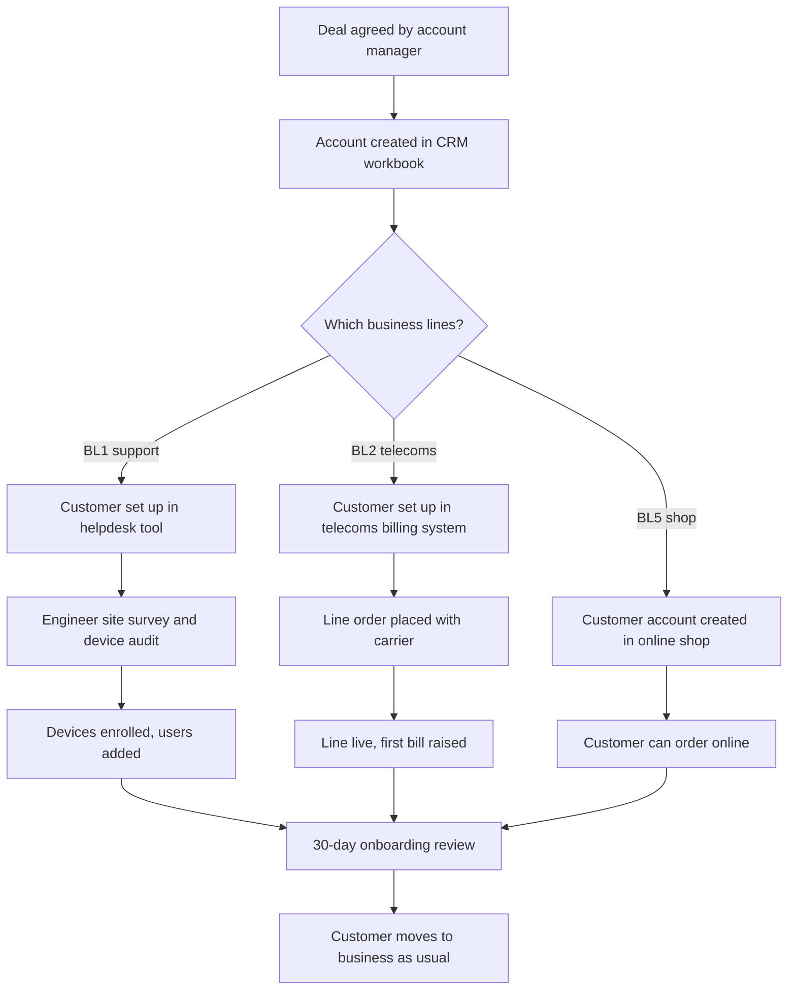
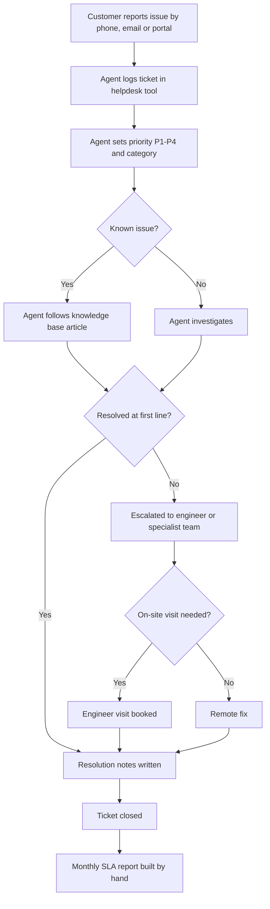
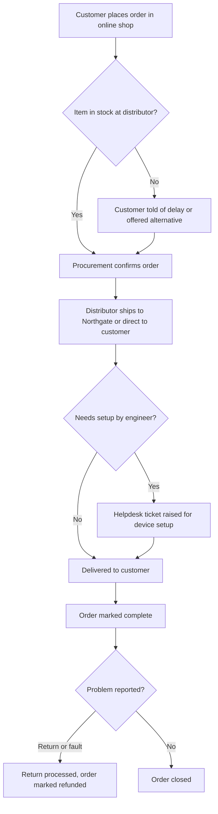
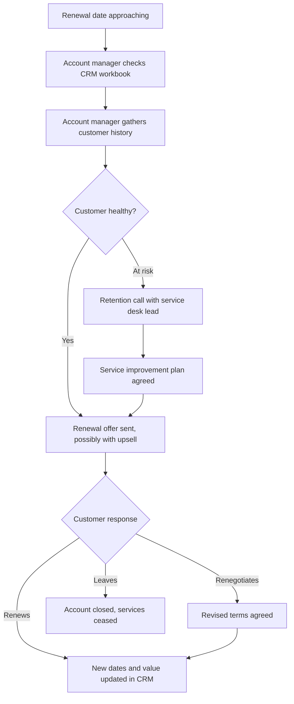

# 01 — Business processes

> **Fictional company, synthetic data.** Northgate IT Services Ltd does not exist. Every
> name, figure and record in this project is invented for a portfolio prototype.

## 1. Company fact sheet

This section fixes the facts that every later document, the data generator and the
evaluation must stay consistent with. If a later step needs a fact that isn't here, it is
added here first.

### 1.1 Company at a glance

| Item | Value |
|---|---|
| Legal name | Northgate IT Services Ltd (fictional) |
| Type | Managed IT services provider (MSP) for small and medium-sized businesses |
| Location | Single office in Stockton-on-Tees; customers across Tees Valley, County Durham and Tyneside |
| Headcount | 25 staff |
| Annual revenue | About £3.2m |
| Customers | About 120 business customers (B2B only; no consumer sales) |
| Typical customer | 10–250 employees; logistics, manufacturing, professional services, education, healthcare (private clinics), retail, charities, construction |
| Data window for this prototype | 1 April 2025 to 30 September 2026 (18 months) |
| As-of date | 30 September 2026 — the day the data is treated as extracted (see §1.7) |

### 1.2 Business lines

| # | Business line | What it sells | Billing model | Approx. share of revenue |
|---|---|---|---|---|
| BL1 | Managed IT support | Service desk, device management, on-site visits | Monthly contract per user/device | 35% |
| BL2 | Broadband and VoIP telecoms | Business broadband, leased lines, hosted phone systems | Monthly line rental plus call charges | 25% |
| BL3 | Cloud hosting | Hosted servers, backup, Microsoft 365 administration | Monthly per resource | 15% |
| BL4 | Bespoke software | Small line-of-business apps and integrations | Fixed-price projects plus annual support | 10% |
| BL5 | Online IT equipment shop | Laptops, peripherals, networking kit | Per order | 15% |

A customer can buy from several lines. Most take BL1; about half also take BL2; BL5 is
used by most customers occasionally. Revenue shares are targets for the data generator,
not measured figures.

**Revenue source per line.** Each line's revenue comes from exactly one source, so no
amount is counted twice (DECISIONS.md D-003).

| Line | Revenue source | Rule |
|---|---|---|
| BL1 Managed IT support | CRM contract lines | Annual value ÷ 12 for each month the contract line is active |
| BL2 Telecoms | Telecoms billing system only | Sum of monthly bills, duplicates removed, credit notes kept and flagged. The CRM's BL2 contract line value is used only for checks (BQ-13), never added to revenue |
| BL3 Cloud hosting | CRM contract lines | Annual value ÷ 12 per active month |
| BL4 Bespoke software | CRM contract lines | Annual value ÷ 12 per active month (a simplification: real project revenue is lumpy) |
| BL5 Shop | Shop orders only | Order totals, excluding cancelled and refunded orders |

BL1, BL3 and BL4 have no transaction source, so their monthly revenue is modelled from
contract values, not measured. Any report showing it labels it "modelled".

### 1.3 Service levels (BL1 support tickets)

| Priority | Meaning | Response target | Resolution target |
|---|---|---|---|
| P1 | Whole business or critical system down | 1 hour | 4 hours |
| P2 | Major function impaired for many users | 2 hours | 8 hours |
| P3 | Single user or workaround available | 4 hours | 24 hours |
| P4 | Request or question | 8 hours | 72 hours |

Simplification for this prototype: all SLA timers run in elapsed (wall-clock) hours, not
business hours. See DECISIONS.md D-001.

### 1.4 Teams

| Team | Staff | Main system used |
|---|---|---|
| Directors (managing, operations) | 2 | Spreadsheets built from exports |
| Finance | 2 | Telecoms billing system, accounts package (out of scope) |
| Account management | 3 | CRM workbook |
| Service desk (team lead + agents) | 7 | Helpdesk tool, knowledge base |
| Field and infrastructure engineers | 3 | Helpdesk tool |
| Telecoms | 2 | Telecoms billing system |
| Cloud | 2 | Hosting control panels (out of scope) |
| Software development | 3 | Project tracker (out of scope) |
| Procurement and shop | 1 | Online shop admin |
| **Total** | **25** | |

### 1.5 Source systems in scope

| System | Holds | Format the prototype uses |
|---|---|---|
| Helpdesk tool | Support tickets | CSV export |
| CRM workbook | Customer accounts, plus one contract line per business line sold (annual value, start date, renewal date) | Excel file (two sheets) |
| Online shop | Orders | JSON from a local REST API |
| Telecoms billing system | Telecoms contracts and monthly bills | CSV export |
| Knowledge base | Help articles and SLA policy documents | Markdown files |

Each system uses its own customer identifier and its own way of writing customer names.
There is no shared customer ID. This is the central integration problem the platform
solves. The full inventory, with known quality problems, is in
`02_as_is_architecture.md`.

### 1.6 Volume targets for the generator

| Data | Target volume over 18 months |
|---|---|
| Customers | 120 |
| Support tickets | about 1,500 |
| Shop orders | about 3,000 |
| Knowledge base | 50 documents (help articles plus SLA policies) |
| New customers onboarded during the window | about 15 (first contract start inside the window) |

### 1.7 As-of date and time rules

The data is treated as extracted at the end of **30 September 2026** (DECISIONS.md D-002).
Every time-relative calculation uses this date, never the real current date, so results
are reproducible whenever the code is run.

| Term | Definition |
|---|---|
| As-of moment | 2026-10-01 00:00, i.e. the end of 30 September 2026 |
| Open ticket | Opened before the as-of moment and `closed_at` empty |
| Ticket age | As-of moment minus `opened_at`, in elapsed hours (D-001) |
| Next 90 days | Renewal date from 1 October to 29 December 2026 inclusive |
| Last 3 months / previous 3 months | July–September 2026 / April–June 2026 (calendar months before the as-of date) |

### 1.8 Identifier formats

One format per record type, used in every document, the generator and the code.

| Record | Format | Example | Issued by |
|---|---|---|---|
| Customer account (canonical) | `ACC-` + 4 digits | `ACC-0042` | CRM workbook |
| CRM contract line | `CL-` + 4 digits | `CL-0107` | CRM workbook |
| Support ticket | `INC-` + 5 digits | `INC-00731` | Helpdesk tool |
| Knowledge base document (articles and policies) | `KB-` + 4 digits | `KB-0012` | Knowledge base |
| Shop customer | Integer | `1042` | Online shop |
| Shop order | `SO-` + 6 digits | `SO-100001` | Online shop |
| Telecoms account | `TEL-` + 5 digits | `TEL-50017` | Telecoms billing system |
| Telecoms contract | `TC-` + 5 digits | `TC-00213` | Telecoms billing system |
| Telecoms bill | `BILL-` + 6 digits | `BILL-004410` | Telecoms billing system |
| Business line | `BL1`–`BL5` | `BL2` | This fact sheet |

Knowledge base documents share one ID series; front matter field `doc_type` (`article`
or `policy`) tells them apart.

## 2. Core processes

Each process below has a map, a short narrative, the systems it touches, and the decisions
managers make in it. The decisions matter most: they are what the platform must support,
and the business questions in `03_requirements.md` are derived from them.

### 2.1 Customer onboarding

**Narrative.** Once a deal is agreed, the account manager adds the customer to the CRM
workbook, with one contract line per business line sold (annual value, start date and
renewal date). Each other team then creates
the customer again in its own system: the service desk in the helpdesk tool, the telecoms
team in the billing system, procurement in the online shop. Each person types the company
name their own way and each system issues its own ID. Nothing links these records except
the name. After 30 days the account manager runs an onboarding review.

**Systems touched:** CRM workbook, helpdesk tool, telecoms billing system, online shop.

| Decision | Who decides | Data needed | How it is done today |
|---|---|---|---|
| Is onboarding on track, or is the customer already unhappy? | Account manager | Tickets raised in the first 30 days, open P1/P2 tickets | Asks the service desk lead; no report exists |
| Have we started billing for everything sold? | Finance | CRM contract lines compared with telecoms bills and support contract | Manual cross-check of workbook against billing export |
| Which customers took only one line and could buy more? | Account manager, directors | Business lines per customer across all systems | Not possible without matching customers by hand |

**Data created here that causes problems later:** the same customer under different names
and IDs in four systems. This is the root cause of most integration work in Layer 1.

### 2.2 Support ticket lifecycle

**Narrative.** Customers report problems by phone, email or the portal. An agent logs the
ticket, types the customer name, and sets a priority and category. If the problem is
known, the agent follows a knowledge base article; otherwise they investigate or escalate
to an engineer. SLA clocks run from the moment the ticket opens (see fact sheet §1.3).
When the ticket closes, the agent writes resolution notes and, if relevant, links the
knowledge base article used. Each month the service desk lead exports tickets to a
spreadsheet to calculate SLA compliance.

**Systems touched:** helpdesk tool, knowledge base. Engineers sometimes check the CRM
workbook to see what the customer pays for.

| Decision | Who decides | Data needed | How it is done today |
|---|---|---|---|
| Which open tickets are about to breach SLA, and who should pick them up? | Service desk lead | Open tickets, priority, time elapsed against target | Scans the helpdesk queue by eye |
| Are we meeting SLA by priority this month? | Service desk lead, operations director | Closed tickets with open and close times, priority | Monthly export to spreadsheet, formulas by hand |
| Which customers generate unusual ticket volume, and why? | Service desk lead, account manager | Tickets per customer over time, categories | Rarely done; customer names in tickets are inconsistent |
| Is the knowledge base helping, and which articles are out of date? | Service desk lead | Article links on tickets, first-line resolution rate, article status | Not measured |
| How should a new agent handle this problem? | Agent | Relevant knowledge base articles and similar past tickets | Searches the knowledge base by keyword, or asks a colleague |

**Data quality problems created here:** customer names typed freely by agents, vague
descriptions, inconsistent categories, personal data (names, emails, phone numbers) in
free text, and missing or wrong links to knowledge base articles.

### 2.3 Order to delivery (online shop)

**Narrative.** Customers order equipment through the online shop using their shop account.
Northgate holds little stock; procurement places each order with a distributor, which ships
either to the office or straight to the customer. Laptops and network kit often need setup,
so procurement raises a helpdesk ticket for an engineer. The shop records order status,
lines, totals and the delivery date. Returns and faults are processed in the shop and
sometimes also generate a support ticket.

**Systems touched:** online shop, helpdesk tool (setup and fault tickets).

| Decision | Who decides | Data needed | How it is done today |
|---|---|---|---|
| How much is each customer spending on equipment, and is it rising or falling? | Account manager | Order totals per customer per month | Shop admin report, but shop accounts don't match CRM names |
| Are orders being delivered on time? | Procurement, operations director | Order date, promised date, delivery date, status | Not measured |
| Which products cause the most faults or setup tickets? | Procurement, service desk lead | Order lines linked to tickets | Not possible; no link between orders and tickets |

**Data quality problems created here:** shop account names that differ from CRM names,
orders with missing delivery dates, cancelled or refunded orders that still appear in
revenue totals unless filtered, and occasional duplicate orders from double submission.

### 2.4 Contract renewal

**Narrative.** Support and telecoms contracts renew annually or every two to three years.
In theory, the account manager reviews the customer 90 days before renewal. In practice,
renewals are often noticed late because the dates sit in a workbook with no reminders.
Before the conversation, the account manager tries to build a picture of the customer:
how many tickets they raised, whether SLAs were met, and whether their spend is growing or
shrinking. That picture comes from four systems that don't share customer IDs, so it is
assembled by hand or skipped.

**Systems touched:** CRM workbook, helpdesk tool, telecoms billing system, online shop.

| Decision | Who decides | Data needed | How it is done today |
|---|---|---|---|
| Which contracts renew in the next 90 days? | Account manager, directors | Renewal dates and contract values | Sorting the workbook by hand, when someone remembers |
| Is this customer at risk of leaving? | Account manager | Ticket trend, SLA breaches on their tickets, spend trend across telecoms and shop | Gut feel; no combined view |
| What should we offer at renewal? | Account manager | Business lines taken, spend by line, service history | Based on what the account manager remembers |
| Where should retention effort go first? | Operations director | At-risk customers ranked by contract value | Not done systematically |

**Data quality problems created here:** missing or out-of-date renewal dates, contract
values typed with inconsistent formats, renewal dates in mixed date formats, and
telecoms contract end dates that don't agree with the CRM workbook.

## 3. Summary of decisions the platform must support

| Process | Decision | Business question (`03`) | Platform layer(s) |
|---|---|---|---|
| Onboarding | Is onboarding on track? | BQ-16 | 1, 3 |
| Onboarding | Are we billing for everything sold? | BQ-13 | 1, 2 |
| Onboarding | Which customers could buy more? | BQ-09 | 2, 3 |
| Tickets | Which tickets are about to breach SLA? | BQ-02 | 4 |
| Tickets | Are we meeting SLA by priority? | BQ-01, BQ-03 | 3 |
| Tickets | Which customers have unusual ticket volume? | BQ-04 | 1, 3 |
| Tickets | Is the knowledge base helping? | BQ-12 | 3 |
| Tickets | How should an agent handle this problem? | BQ-11 | 5 |
| Orders | How much is each customer spending, and which way is it trending? | BQ-07 | 2, 3 |
| Orders | Are orders delivered on time? | BQ-10 | 3 |
| Orders | Which products cause faults? | Out of scope (`03` §2) | — |
| Renewal | Which contracts renew in the next 90 days? | BQ-05 | 3, 4 |
| Renewal | Is this customer at risk? | BQ-06 | 1–5 |
| Renewal | What to offer at renewal? | BQ-08 | 1, 2, 5 |
| Renewal | Where should retention effort go first? | BQ-06 (ranking) | 3 |

Two further questions support decisions outside these four processes: BQ-14 (can today's
figures be trusted?) and BQ-15 (directors' weekly summary). Full definitions, owners and
acceptance tests are in `03_requirements.md`.
