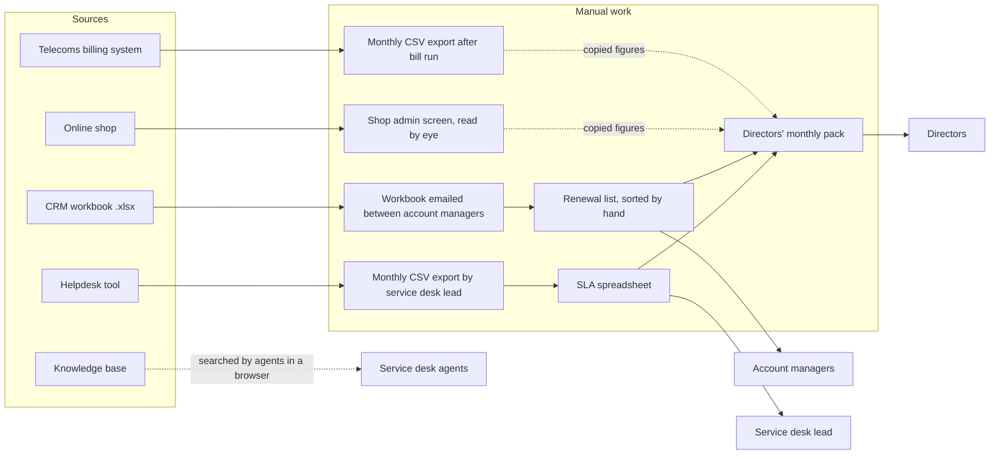

# 02 — As-is architecture

> **Fictional company, synthetic data.** All systems, identifiers and records describe the
> invented Northgate IT Services Ltd.

This document records how Northgate's data is held and moved today, before the platform
exists. Section 1 is the inventory of source systems. Section 2 shows
how data flows between them and where the pain points are.

## 1. Source system inventory

### 1.1 Summary

| System | Owner | Holds | Format used in prototype | Customer identifier | How data gets out today | Refresh |
|---|---|---|---|---|---|---|
| Helpdesk tool | Service desk lead | Support tickets | CSV export | None — customer name typed by agent | Manual CSV export | Monthly, for SLA report |
| CRM workbook | Account management | Customer accounts; contract lines per business line | Excel (.xlsx), two sheets | `ACC-0001` style | The workbook itself, emailed around | Edited ad hoc |
| Online shop | Procurement | Orders and order lines | JSON from REST API | Numeric shop customer ID, e.g. `1042` | Admin screen; API exists but unused | Live |
| Telecoms billing system | Telecoms team, Finance | Telecoms contracts, monthly bills | CSV export | Account number, e.g. `TEL-50017` | Manual CSV export | Monthly, after bill run |
| Knowledge base | Service desk lead | Help articles, SLA policies | Markdown with front matter | Not applicable (documents use `KB-0001`) | Read in a browser | Edited ad hoc |

There is no shared customer key. The only thing that links a customer across systems is
the company name, which each team writes differently.

### 1.2 Helpdesk tool

- **Purpose:** log and track support tickets for BL1 managed IT support.
- **Record:** one row per ticket.
- **Key fields:** `ticket_id` (e.g. `INC-00731`), `opened_at`, `first_responded_at`,
  `closed_at`,
  `priority` (P1–P4), `category`, `customer_name` (free text), `description`,
  `resolution_notes`, `kb_article_id` (optional), `agent`.
- **Identifier scheme:** tickets have IDs; customers do not. Agents type the customer name
  each time.
- **Known quality problems:**
  - Customer names typed inconsistently: abbreviations, lower case, missing "Ltd", typos.
  - Descriptions that are vague ("not working", "issue with PC") or contain typos.
  - Personal data in free text: contact names, email addresses, phone numbers.
  - Categories used inconsistently ("Email", "email", "E-mail", "Outlook").
  - Open tickets have empty `closed_at`; a few closed tickets have `closed_at` earlier
    than `opened_at`.
  - `first_responded_at` missing on some tickets (the agent skipped the status change),
    and occasionally earlier than `opened_at`.
  - `kb_article_id` often blank even when an article was used; sometimes points to a
    superseded article.

### 1.3 CRM workbook

- **Purpose:** the account managers' list of customers and contracts.
- **Records:** two sheets.
  - *Accounts* — one row per customer, including shop-only customers: `account_id`
    (`ACC-0001`), `company_name`, `sector`, `account_manager`, `customer_since`,
    `status` (active, closed), `closed_date`.
  - *Contract lines* — one row per business line sold to a customer: `line_id`
    (`CL-0001`), `account_id`, `business_line` (BL1–BL4), `annual_value`,
    `contract_start`, `renewal_date`. Shop purchases (BL5) have no contract line.
- **Headers:** written in the workbook as people type them ("Account ID", "Annual Value
  (GBP)"); the semantic layer maps them to the field names above.
- **Identifier scheme:** sequential account IDs; the most trusted customer list, so the
  platform treats it as the master list for canonical customers.
- **Known quality problems:**
  - Dates in mixed formats in the same column (`03/04/2025`, `2025-04-03`,
    `3 Apr 2025`), including ambiguous day/month order.
  - Contract values typed inconsistently (`£12,000`, `12000`, `12k`).
  - Some renewal dates missing.
  - A few duplicate rows for the same customer, created when someone re-added an account.
  - Some customers listed as active who have no activity in any other system.
  - BL2 contract lines for customers with no matching telecoms account, and telecoms
    accounts with no BL2 contract line in the CRM.

### 1.4 Online shop

- **Purpose:** B2B equipment orders (BL5).
- **Record:** one order per JSON object, with nested order lines.
- **Key fields:** `order_id` (e.g. `SO-100001`), `customer_id` (numeric shop ID),
  `company_name` (as entered at shop sign-up), `order_date`, `status` (placed,
  dispatched, delivered, cancelled, refunded), `promised_date`, `delivered_date`,
  `lines` (sku, product, quantity, unit_price, line_total), `order_total`. Amounts exclude VAT.
- **Identifier scheme:** the shop issues its own numeric customer IDs. A customer can
  have more than one shop account (for example, separate accounts for two offices).
- **Access:** paginated REST API with a date filter. The platform must call the API, not
  read a file.
- **Known quality problems:**
  - Shop company names differ from CRM names.
  - Duplicate shop accounts for one customer.
  - Duplicate orders from double submission (same customer, same lines, minutes apart).
  - Missing `delivered_date` on delivered orders.
  - Cancelled and refunded orders that inflate revenue unless filtered.
  - Occasional negative or zero quantities.

### 1.5 Telecoms billing system

- **Purpose:** contracts and monthly bills for BL2 broadband and VoIP.
- **Records:** two exports: contracts (one row per service contract) and bills (one row
  per account per month).
- **Key fields — contracts:** `contract_ref` (`TC-00001`), `account_no` (`TEL-50017`),
  `account_name`, `service_type`, `monthly_charge`, `start_date`, `end_date`.
- **Key fields — bills:** `bill_id` (`BILL-000001`), `account_no`, `bill_month`, `bill_date`
  (last day of the month), `line_rental`, `call_charges`, `total`. Amounts exclude VAT.
- **Identifier scheme:** the billing system's own account numbers; names written in the
  billing system's style (often upper case, abbreviated to fit a field length).
- **Known quality problems:**
  - Account names always in the system's own style: upper case, legal suffix dropped,
    cut to 20 characters. Two different customers can end up with the same name
    ("ROWLEY & PEARSON SOL" for the LA-1 look-alike pair).
  - Contract end dates that disagree with CRM renewal dates.
  - Bill months in mixed formats (`2025-04`, `Apr-25`, `04/2025`).
  - Occasional duplicate bill rows from a re-run bill export.
  - A few negative totals (credit notes) that need to be kept but flagged.

### 1.6 Knowledge base

- **Purpose:** help articles for service desk agents and the SLA policy documents.
- **Record:** one Markdown file per document, with YAML front matter.
- **Key fields (front matter):** `id` (`KB-0001` format for every document), `title`,
  `type` (article, policy), `topic_ids`, `author` (a team or role, never a person),
  `created`, `updated`, `status` (current, superseded), `superseded_by`, and
  `superseded_on` on the superseded article. The documents live in `knowledge_base/`
  and are committed to the repository; `knowledge_base/_meta.yaml` records which
  article was superseded and which pairs are near-duplicates.
- **Known quality problems:**
  - Near-duplicate articles written by different teams for the same problem; one pair
    disagrees on a detail.
  - At least one superseded article that is still easy to find and still linked from
    tickets.
  - Inconsistent categories compared with the helpdesk tool.

### 1.7 Quality problems the synthetic data must contain

The Phase 1 generator injects each problem above as a deliberate defect and records every
injected instance in `data/ground_truth/known_issues.csv`, so the platform's handling of
it can be measured.

**Date conventions for non-ISO values (QI-03).** Each source writes its non-ISO dates in one
convention, so every date can be parsed by rule and none has to be guessed:

| Source | Non-ISO formats | Rule for ambiguous values such as 03/04/2025 |
|---|---|---|
| CRM workbook | `dd/mm/yyyy` or `d Mon yyyy` (e.g. `3 Apr 2025`) | UK day-first: 3 April 2025 |
| Helpdesk export | `dd/mm/yyyy HH:MM` | UK day-first |
| Telecoms bills (`bill_month`) | `Mon-yy` (e.g. `Apr-25`) or `mm/yyyy` | Never ambiguous |

**Shop names (QI-01)** are set once per shop account at sign-up, so the 50% rate applies to
shop accounts, and every order from a renamed account carries the same variant. All eight
second shop accounts have a variant name.

**CRM duplicates (QI-04)** are new rows with their own `ACC-` IDs (ACC-0121 onwards);
`data/ground_truth/crm_account_map.csv` maps every raw account ID to the real account.

| ID | Problem | Systems | How Layer 1 is expected to handle it |
|---|---|---|---|
| QI-01 | Same customer under different names | All four data systems | Entity resolution with review queue |
| QI-02 | No shared customer ID | All four data systems | Entity resolution; CRM as master list |
| QI-03 | Mixed date formats | CRM, telecoms, helpdesk | Parse to ISO dates; reject ambiguous or unparseable values with a reason |
| QI-04 | Duplicate records | CRM, shop orders, telecoms bills | Deduplicate with a logged rule |
| QI-05 | Invalid values | All | Validation rules; rejected-rows log |
| QI-06 | Inconsistent categories | Helpdesk, knowledge base | Controlled vocabulary mapping |
| QI-07 | Personal data in free text | Helpdesk | Masking before any LLM call (Phase 6) |
| QI-08 | Missing values (renewal dates, delivery dates, first-response times, KB links) | CRM, shop, helpdesk | Kept and flagged, not invented |
| QI-09 | Superseded knowledge base article | Knowledge base | Excluded from retrieval |
| QI-10 | Cancelled, refunded and credit-note amounts | Shop, telecoms | Cancelled and refunded orders excluded from revenue; credit notes kept and flagged |
| QI-11 | Telecoms line sold in CRM with no telecoms account, or the reverse | CRM, telecoms | Listed by the BQ-13 check after entity resolution |

The ground truth also contains a few **look-alike company pairs**: different companies with
confusingly similar names (for example "Cleveland Accountants Ltd" and "Cleveland
Accountancy Ltd"). They are not a defect but a trap for entity resolution: matching them
together would be a false merge. They are kept separate from QI-04's CRM duplicates, which
are the same company entered twice.

**Named evaluation case for Phase 2.** Two at-risk customers sit in look-alike pairs:
"Rowley & Pearson Solicitors Ltd" (LA-1, legal-form pair) and "Norton Interior Design Ltd"
(LA-4, near-identical trade word). If entity resolution wrongly merges the LA-1 pair,
the at-risk customer's ticket rise is mixed with its healthy look-alike's tickets and its
at-risk signal can disappear. Phase 2 evaluation reports this case by name. The pair is
harder still in telecoms, where the billing system writes both names identically
("ROWLEY & PEARSON SOL"); only the account number and other evidence can separate them.

**Named evaluation case for Phase 2: the shop account switch.** One healthy customer
(ACC-0047 for the project seed) moves all its shop ordering from its first shop account to
a second one from July 2026. Seen per shop account, the first account's spend collapses
and looks like an at-risk spend fall; across both accounts, spend actually rises. If
entity resolution fails to link the two shop accounts to one customer, BQ-06 raises a
false alarm. Phase 2 evaluation reports this case by name. (One at-risk customer,
ACC-0004, also has two shop accounts, so its fall is only visible on combined spend.)

## 2. How data flows today

**How to read it.** Solid arrows are regular manual steps. Dotted arrows are figures copied
or looked up by hand. No system talks to another; every join between them is made by a
person in a spreadsheet, if it is made at all. The shop's API exists but nothing uses it.

### 2.1 Pain points

| ID | Pain point | Effect on decisions | Decisions affected (`01`) | Quality problems (§1.7) |
|---|---|---|---|---|
| PP-01 | No single view of a customer across systems | Account managers can't see tickets, telecoms spend and shop spend together | 2.1 upsell; 2.4 at risk, what to offer | QI-01, QI-02 |
| PP-02 | Reports are built by hand each month | Figures are a month old, take hours to produce, and contain copy errors | 2.2 SLA by priority; directors' pack | QI-03, QI-04 |
| PP-03 | No early warning on SLA breaches | Breaches are found after they happen, in the monthly report | 2.2 tickets about to breach | QI-03 |
| PP-04 | Renewals noticed late | Renewal conversations start without preparation, or after the date | 2.4 renewals in 90 days | QI-03, QI-08 |
| PP-05 | Revenue figures disagree between sources | Shop and telecoms totals include cancelled orders, refunds and duplicate bills unless someone filters them | 2.3 spend trend; 2.4 at risk | QI-04, QI-10 |
| PP-06 | Knowledge is hard to find | Agents search by keyword, find near-duplicates or outdated articles, or ask a colleague | 2.2 how to handle a problem; is the KB helping | QI-06, QI-09 |
| PP-07 | Personal data spread through free text | Any new tool that reads tickets, especially an LLM, risks exposing it | All ticket-based decisions | QI-07 |
| PP-08 | No definitions agreed for key measures | "Revenue", "active customer" and "SLA met" mean different things in different spreadsheets | All | QI-05, QI-06 |

### 2.2 Target state (preview)

The platform replaces the manual layer in the diagram with five layers:

1. **Data ingestion and semantic integration** pulls from every source automatically
   (including the shop API), validates rows, matches customers to one canonical record,
   and maps fields to agreed business terms. Addresses PP-01, PP-05, PP-08.
2. **Unified reporting dataset** holds one star schema built from that clean data, with
   reconciliation checks against source totals. Addresses PP-02, PP-05.
3. **Business analytics and visualisation** computes agreed KPIs and shows them in a
   dashboard and in Power BI. Addresses PP-02, PP-08.
4. **Workflow automation** raises SLA breach-risk and renewal alerts and refreshes the
   data on a schedule. Addresses PP-03, PP-04.
5. **LLM capability** answers questions over the knowledge base and the unified data,
   with citations, abstention and masking of personal data. Addresses PP-06, PP-07, and
   gives account managers PP-01's single view in plain English.

The business questions each layer must answer are listed in `03_requirements.md`.
