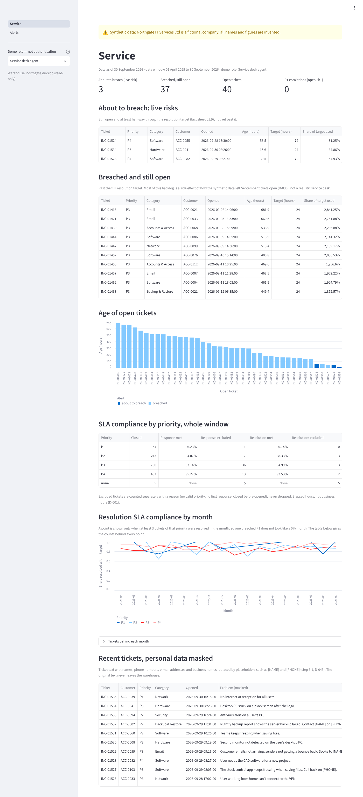
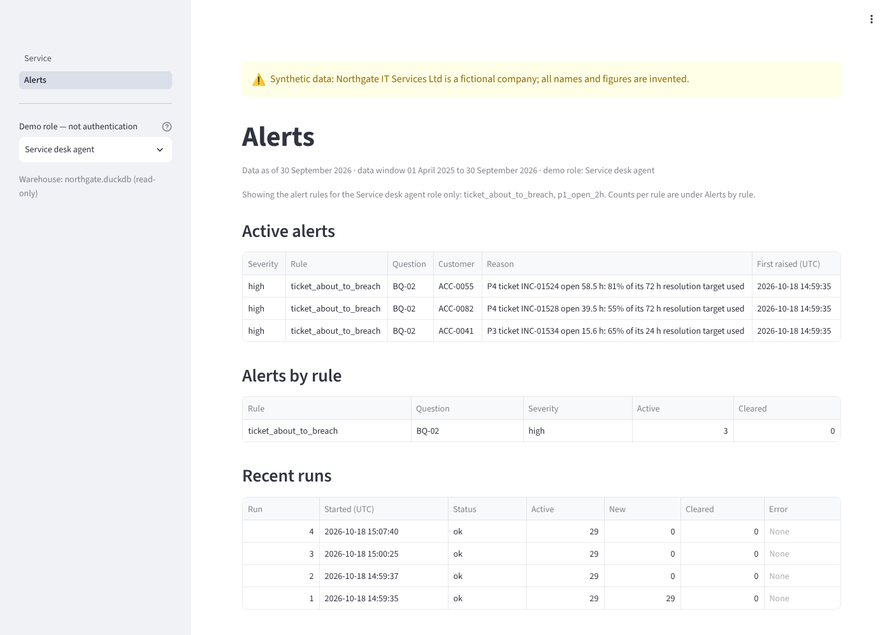

# Phase 6 summary: masking, roles, audit log and Docker

Prototype for the fictional Northgate IT Services Ltd. All data is synthetic. Decisions D-043 to D-047 in
`DECISIONS.md` hold the detail; this page is the overview.

## What was built

| Step | What | Where |
|---|---|---|
| 6.1 | Personal data in ticket text replaced by `[NAME]`, `[PHONE]`, `[EMAIL]` and `[CUSTOMER]`, using general rules (UK phone formats, email pattern, names after context cues and in email addresses) and the warehouse's own name lists; nothing from the generator | `pipeline/mask/`, table `ticket_text_masked`, view `v_ticket_masked` (D-043) |
| 6.2 | Decision: masked tickets go to the warehouse, exports and dashboard only; assistant ticket search is future work | `docs/03_requirements.md` BQ-11 (D-043) |
| 6.3 | Four demo roles (service desk agent, account manager, operations director, data steward) decide the pages, business names, alert rules and assistant tools each sees; the assistant gets roles through a subclass, without editing the frozen code | `config/roles.yaml`, `dashboard/common.py`, `pipeline/roles/` (D-044) |
| 6.4 | Append-only audit log with a SHA-256 hash chain, a head anchor in `head.txt` after every pipeline run, a 365-day retention report, and random session IDs | `pipeline/audit/`, `python -m pipeline.audit.verify` (D-045) |
| 6.5 | Docker: a pipeline image and a dashboard-only image, a base pinned by multi-architecture digest, non-root user, named volumes only, least-privilege mounts, health-checked startup order | `Dockerfile`, `docker-compose.yml` (D-046) |
| 6.6 | Review: full tests, git history check, blanket `data/` ignore, refreshed screenshots, this summary | D-047 |

## Measured results

| What | Result | How it was measured |
|---|---|---|
| Masking, held-out half (789 tickets, 302 planted spans) | names 152/152, phones 95/95, emails 55/55; 0 false masks | `eval/masking_eval.py --final`, run once; tuned on the dev half only (D-043) |
| Masking, independent check by the project author | 0 of 579 planted values in the masked export; placeholder counts equal planted counts | The author's own check, 2026-10-18 |
| Roles | 31 tests: every role against every page (refused, shown, names) and all 14 assistant tools (offered, refused); operations director requests byte-identical to the frozen assistant | `tests/test_roles.py` (D-044) |
| Audit log | Edits, deletions, reordering and truncation detected; a full consistent rewrite is not (by design, see limits) | `tests/test_audit.py` (D-045) |
| Docker on the author's Intel Mac | Same figures as the host (total revenue £4,673,914.13, 68 Unknown rows, 29 alerts, 280 KB sections); dashboard non-root with read-only warehouse; audit chain intact (27 entries); host data untouched | Run of 2026-10-19 (D-046) |
| Tests | 427 passing | `uv run pytest` |
| Git history | No `.env`, no file under `data/`, no `sk-ant-` string in any of the 69 commits | 6.6 check (D-047) |

## Screenshots

| Operations director | Service desk agent |
|---|---|
|  |  |
|  |  |

The data steward sees only Data quality, with the review queue's names: `screenshots/data_quality_steward.png`.

## Known limitations

1. **Synthetic personal data is easier than real data.** The planted names, phones and emails use a few fixed phrasings and standard formats, with no typos, nicknames, initials or addresses. 100% here does not predict recall on real tickets; real use needs a reviewed sample and probably a trained recogniser (D-043).
2. **A hint before the held-out masking run.** The answer key's overall QI-07 counts were seen while learning its format, and the mask counts over all tickets matched them before the held-out half was scored (D-043).
3. **Roles are a demo, not authentication.** Anyone can pick any role in the sidebar. Real access control needs sign-in and server-side enforcement (D-044).
4. **Restricted roles were not evaluated with held-out questions.** The assistant's 13/14 held-out score applies to the all-tools role (operations director) only (D-044).
5. **The Alerts page shows all-rule totals in "Recent runs" to every role.** These are counts only, with no records or names, but they are not limited to the role's rules (found in the 6.6 screenshots; not changed).
6. **The audit log records roles and sessions, not people**, because there is no sign-in. It detects partial edits, not a full rewrite by someone who can write both `audit.jsonl` and `head.txt`; production would use write-once storage (D-045).
7. **BQ-11 is partly met.** Knowledge-base and data questions are answered; past-ticket search is deferred so the held-out score stays valid (D-043).
8. **Docker images were not scanned for vulnerabilities**, and the base image digest will age (D-046).
9. **Docker volumes are readable by anyone who can run `docker` on the machine**, including the warehouse, the answer keys in the `work` volume, and the audit log (D-046).
10. **Static checks miss runtime problems.** Both Docker fixes (file permissions, a missing README) were found only by running the images on the Mac (D-046).
